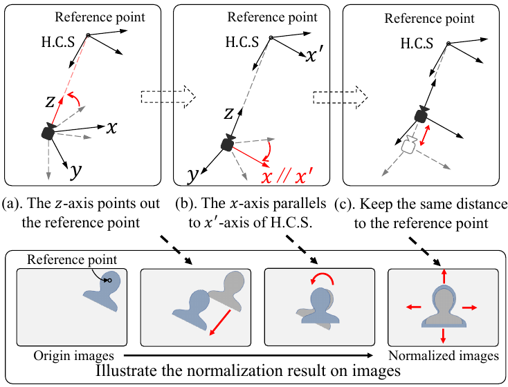
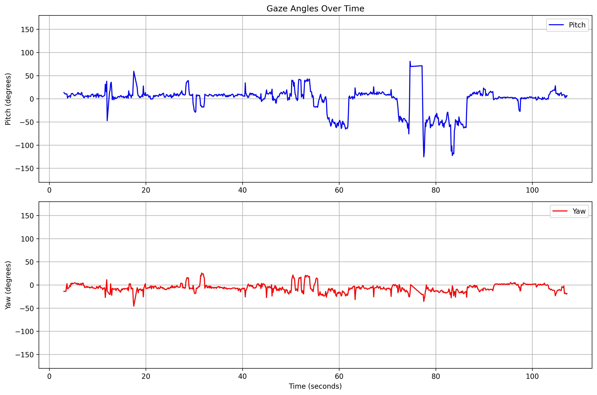
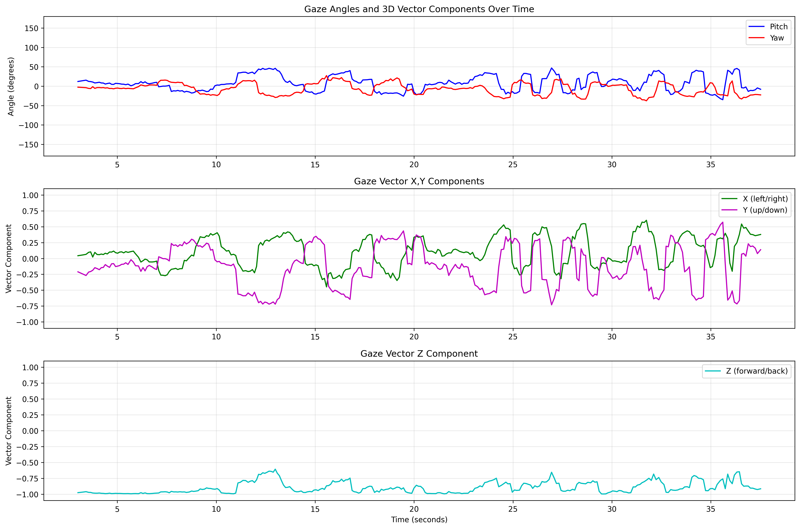
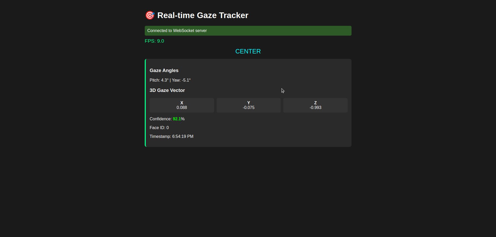
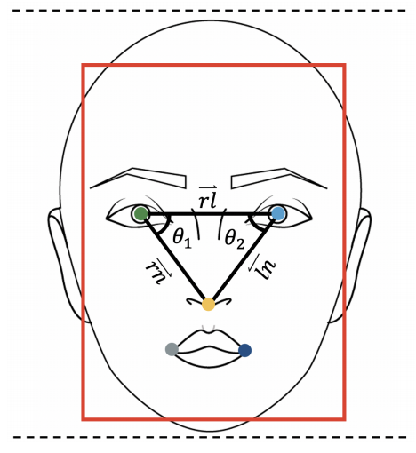
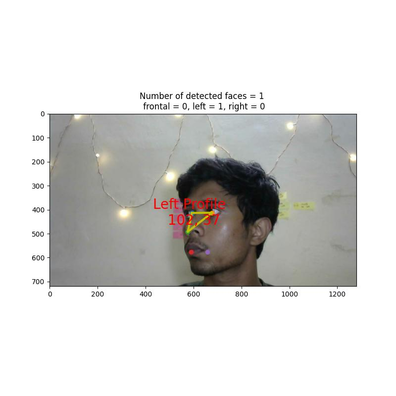

# Gaze Direction Finder

Building a lightweight, local-only gaze prototype for Cluely that uses a standard webcam to infer eye/pupil position and head pose, classify gaze (left/right/up/down/center) and emit a continuous gaze vector at *~15-30 FPS*. Ship a tiny library plus sample app with a swappable face/landmark detector, quick five-point calibration (optional), temporal smoothing and confidence scores, and two outputs: a debug overlay (face/eye ROI, ray, label) and a programmatic stream (console NDJSON and optional local WebSocket with a minimal JS client). Keep it privacy-first (no frame storage or network by default), configurable (FPS, resolution, model, smoothing), and replaceable (clean interfaces). Include a brief README (setup, architecture, calibration, limits), a simple demo clip or screenshots, and an example consumer (browser or Electron). Aim for CPU-only performance, *<100 ms latency*, and easy integration so anyone can run a demo and see live gaze events in minutes.

## Overview

This project implements a ResNet-based gaze estimation model that predicts 2D gaze direction from facial images. It supports both MPIIFaceGaze and Gaze360 datasets for training and evaluation.



### Architecture
- **Model**: GazeTracker (ResNet-based CNN)
- **Input**: 448x448 RGB face images
- **Output**: Pitch and yaw gaze angles (binned classification + continuous regression)
  - **Pitch**: Vertical gaze angle (up/down, θ ∈ [-42°, +42°])
  - **Yaw**: Horizontal gaze angle (left/right, φ ∈ [-42°, +42°])
  - **Gaze Vector**: 3D direction = (-cos(θ)sin(φ), -sin(θ), -cos(θ)cos(φ))
- **Datasets**: MPIIFaceGaze (leave-one-out), Gaze360 (train/test split)

## Quick Start

### Setup
```bash
python3 -m venv venv
source venv/bin/activate
pip install -r requirements.txt
```

### Training
```bash
# MPIIFaceGaze dataset
python train.py --dataset mpiigaze --num_epochs 50 --batch_size 16 --lr 0.00001

# Gaze360 dataset
python train.py --dataset gaze360 --num_epochs 50 --batch_size 16 --lr 0.00001
```

### Testing
```bash
python test.py --dataset mpiigaze --snapshot output/snapshots/model.pkl
```

### Pipeline Usage
```bash
# Debug overlay only
python detect.py --snapshot models/Gaze_Tracker.pkl --cam 0

# With NDJSON console output
python detect.py --snapshot models/Gaze_Tracker.pkl --cam 0 --output-json

# With WebSocket server (open gaze_client.html in browser)
python detect.py --snapshot models/Gaze_Tracker.pkl --cam 0 --websocket 8765

# Five-point calibration for improved accuracy
python detect.py --snapshot models/Gaze_Tracker.pkl --cam 0 --calibrate

# Temporal smoothing for stable output
python detect.py --snapshot models/Gaze_Tracker.pkl --cam 0 --smoothing --smoothing-type both

# All features combined
python detect.py --snapshot models/Gaze_Tracker.pkl --cam 0 --calibrate --smoothing --output-json --websocket 8765
```
- download the trained model from here: [Google Drive](https://drive.google.com/file/d/1sR9gdm9MOB_uCAFiMMRyV5Q2u2I8-QMr/view?usp=sharing) and save in `models/` directory




*Real-time gaze tracking output showing pitch/yaw angles (top), X/Y vector components for horizontal/vertical gaze direction (middle), and Z component for depth perception (bottom). The plot demonstrates smooth gaze transitions and 3D vector representation over a 37-second capture session.*
- Top panel: Pitch/yaw angles in degrees
- Middle panel: X/Y vector components (horizontal/vertical gaze direction)
- Bottom panel: Z component (depth/forward-back direction)


*Browser client with WebSocket and JSON streaming for real-time output - gaze direction label, pitch/yaw angles, 3D gaze vector, and temporal smoothing. The client displays live gaze events, confidence scores, and overlay graphics for debugging and visualization.*

## Face Pose Detection


*Integrated MTCNN-based face pose detection showing Left Profile classification with landmark triangulation and angle measurements (Left: 107°, Right: 37°). The system combines gaze estimation with head orientation analysis for comprehensive face tracking.*

## Key Features
- **CPU/GPU Support**: Automatic device detection with CPU fallback
- **Multiple Architectures**: ResNet18/34/50/101/152 support
- **Face Detection**: Integrated RetinaFace detector
- **Face Pose Detection**: MTCNN-based head orientation (Frontal/Left/Right Profile)
- **Five-Point Calibration**: Personalized accuracy improvement via user calibration
- **Temporal Smoothing**: Configurable smoothing (moving average, exponential, combined)
- **Cross-Platform**: Works on Ubuntu, macOS, Windows
- **Dual Output Modes**: Debug overlay + programmatic streams
- **Real-time Streaming**: NDJSON console output + WebSocket server
- **Live Dashboard**: HTML/JS client for real-time visualization
- **Privacy-First**: Local processing, no data storage by default

## Datasets
- **MPIIFaceGaze**: 15-fold cross-validation, ±42° gaze range
- **Gaze360**: Full 360° gaze coverage, larger scale

## Advanced Features

### Five-Point Calibration
Improves gaze accuracy by learning user-specific correction matrices:

1. **Setup**: Run with `--calibrate` flag to start calibration routine
2. **Process**: Look at 5 screen points (center + 4 corners) for 3 seconds each
3. **Collection**: System records ~30 samples per point (raw model output vs known target)
4. **Correction**: Calculates linear transformation matrices using least squares regression
5. **Persistence**: Saves calibration to `calibration.json` for future sessions

**Mathematical Process**:
```
screen_x = a1*pitch + b1*yaw + c1
screen_y = a2*pitch + b2*yaw + c2
```

The calibration compensates for individual differences in eye shape, head position, and systematic model biases.

### Temporal Smoothing
Reduces gaze jitter through configurable filtering:

- **Moving Average**: Smooths over N recent samples (default: 5)
- **Exponential**: Weighted smoothing with alpha parameter (default: 0.3)
- **Combined**: Applies both filters sequentially

**Options**:
```bash
--smoothing-type [moving_average|exponential|both]
--smoothing-buffer-size 5  # Moving average window
--smoothing-alpha 0.3      # Exponential smoothing factor
```

## Performance
- **Input Resolution**: 448×448 pixels
- **Angular Range**: ±42° (MPII), ±180° (Gaze360)
- **Face Pose**: Frontal, Left Profile, Right Profile classification
- **Inference**: Real-time capable on modern CPUs (~15-30 FPS)
- **Latency**: <100ms end-to-end processing
- **Calibration**: ~30 seconds setup time, persistent across sessions
- **Smoothing**: Real-time filtering with configurable parameters